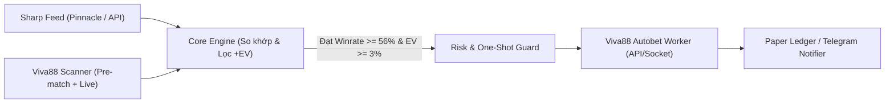

# ABITRADE — Hệ thống Phân tích & Autobet Bóng đá 1 Cửa (Viva88 / Saba Sports)

Tài liệu tổng hợp toàn bộ kiến trúc, phương pháp định lượng và hướng dẫn vận hành hệ thống **Autobet 1 Cửa (Single-Sided Value & Steam Betting)** trên nền tảng **Viva88 (Saba Sports)** — tuyệt đối không đánh 2 đầu, không xả/bù khi kèo nhảy tỉ lệ mới.

---

## Phần 1: Cơ sở Toán học & Phương pháp Lọc kèo "Nhiều Kèo + Tỉ lệ Thắng Cao"

Trong cá cược định lượng (Quantitative Betting), phương pháp chỉ đánh 1 đầu và giữ đến hết trận dựa trên 3 thuật toán cốt lõi để vừa có **số lượng kèo lớn** vừa đảm bảo **tỉ lệ thắng (Win Rate) + lợi nhuận kỳ vọng (+EV) cao**:

### 1. 3 Phương pháp lọc kèo cốt lõi

1. **Sharp-to-Soft Value Betting (Soi chiếu nhà cái sắc bén)**
   - **Nguyên lý**: Các nhà cái "Sharp" (Pinnacle/PS3838, SBOBET, sàn Betfair) có thuật toán định giá sát xác suất thực nhất thế giới.
   - **Cách phần mềm chạy**: Tự động lấy Odds của Pinnacle $\rightarrow$ Khử phế nhà cái (De-vigging bằng công thức *Power* hoặc *Shin*) để ra **Xác suất thắng thực ($P_{\text{true}}$)** $\rightarrow$ Quét bảng kèo **Viva88**.
   - **Điều kiện nổ kèo**: Chọn các kèo có $P_{\text{true}} \ge 56\%$ (đảm bảo tỉ lệ thắng cao) **VÀ** có lợi thế giá ($\text{EV} = P_{\text{true}} \times \text{Odds} - 1 \ge 3\%$).

2. **Steam Chasing / Dropping Odds (Bắt sóng dòng tiền lớn)**
   - **Nguyên lý**: Khi dòng tiền lớn (Smart Money/Syndicate) đổ vào 1 cửa, Odds tại Pinnacle/Châu Á sẽ tụt rất nhanh trong vài chục giây.
   - **Cách phần mềm chạy**: Theo dõi biến động Odds theo thời gian thực (Tick data). Khi phát hiện 1 cửa bị ép giá mạnh (ví dụ tụt $\ge 0.08$ trong $< 120$ giây), phần mềm lập tức báo/đặt đúng cửa đó ở Viva88 khi nhà cái chưa kịp giảm giá.

3. **Quét đa thị trường (Pre-match + Live, Handicap + O/U + Phạt góc)**
   - Viva88 (hệ thống Saba/IBC) thường **trễ 1s – 4s** so với Pinnacle/Singbet ở kèo **Live (Rung), Giải cỏ và Phạt góc (Corners)**. Đây là khu vực tạo ra **số lượng kèo lớn mỗi ngày**.

### 2. Điểm ngọt (Sweet Spot) & Quản lý vốn

- **Điểm ngọt của Tỉ lệ thắng & Odds**:
  - Tránh kèo Win Rate 80–85% nhưng Odds quá thấp (1.20–1.25) vì thắng 4 mã chỉ cần gãy 1 mã là âm vốn.
  - **Vùng tối ưu**: Lọc kèo Châu Á (Handicap), Tài Xỉu (O/U) hoặc Phạt góc có **Odds Decimal từ 1.65 – 2.05** (tương đương HK `0.65 – 1.05`) với **Win Rate thực đạt 56% – 68%**.
- **Quản lý vốn tự động**: Tích hợp công thức **Fractional Kelly (1/4 Kelly)** để tự tính % vốn nên đánh cho từng kèo, kèm cơ chế làm tròn số tiền (bội số của 5 hoặc 10) để chống bị nhà cái phát hiện bot.

---

## Phần 2: Kiến trúc Hệ thống Autobet 1 Cửa trên Viva88



### Cấu trúc thư mục dự án

```text
ABITRADE/
├── config/
│   └── settings.yaml         # Cấu hình tài khoản Viva88, vốn, ngưỡng EV%, Winrate%
├── data/
│   └── paper_ledger.json     # Sổ cái lưu lịch sử vé cược và kết quả Paper Trade
├── src/
│   ├── models.py             # Cấu trúc dữ liệu kèo, tín hiệu +EV và vé cược
│   ├── feeds/
│   │   ├── viva88_client.py  # Quét odds & Đặt cược Viva88 (Hỗ trợ Giả lập & Live)
│   │   └── sharp_feed.py     # Lấy odds chuẩn từ Pinnacle / The-Odds-API / Simulator
│   ├── engine/
│   │   ├── matcher.py        # Ghép cặp trận đấu tự động (Viva88 <-> Sharp)
│   │   ├── analyzer.py       # Tính Power De-vig, +EV, phát hiện Steam Move & Kelly
│   │   └── risk_manager.py   # Quản lý vốn & Khóa chặt 1 cửa/trận (One-shot Rule)
│   └── main.py               # Vòng lặp bất đồng bộ (asyncio) chạy kiểm thử & thống kê
└── requirements.txt
```

---

## Phần 3: Chi tiết các Module đã xây dựng

1. **Cấu hình trung tâm (`config/settings.yaml`)**:
   - Chế độ `mode: "simulation"` (Paper Trade) hoặc `"live"`, vốn khởi điểm `10,000`, công thức `1/4 Kelly` (tự làm tròn bội số của `5`), lọc kèo có **Winrate $\ge 56\%$** và **$\text{EV} \ge 3.0\%$**.
2. **Bộ thu thập Sharp Feed (`src/feeds/sharp_feed.py`)**:
   - Tích hợp sẵn API miễn phí của **The-Odds-API** (lấy odds Pinnacle thực tế) và luồng dữ liệu **Hybrid Simulator** có đủ 4 loại kèo: `HDP` (Chấp), `OU` (Tài Xỉu bàn), `CORNER_OU` (Tài Xỉu góc), `CORNER_HDP` (Chấp góc) cả **Pre-match** lẫn **Live (Rung)**.
3. **Bộ phân tích & Khử phế (`src/engine/analyzer.py`)**:
   - Dùng thuật toán **Power De-vig** (`devig_power`) để tính chính xác xác suất thắng thực ($P_{\text{true}}$) và bắt sóng **Steam Drop** (`record_sharp_tick`) khi Pinnacle sụt giá $\ge 8$ xu.
4. **Bộ ghép cặp trận đấu tự động (`src/engine/matcher.py`)**:
   - Dùng Fuzzy Matching (`rapidfuzz`) chuẩn hóa tên đội bóng khác nhau giữa Pinnacle và Viva88 (ví dụ: *Arsenal FC* $\leftrightarrow$ *Arsenal*, *Urawa Red Diamonds* $\leftrightarrow$ *Urawa Reds*).
5. **Kỷ luật khóa 1 cửa & Sổ cái Paper Trade (`src/engine/risk_manager.py`)**:
   - Khóa chặt theo `(Trận đấu + Loại kèo)`. Khi đã vào 1 mã ở chu kỳ #1, sang các chu kỳ sau dù kèo biến động vẫn tự động báo `[SKIP - ĐÃ KHÓA 1 CỬA]` (tuyệt đối không nhồi/bù).
6. **Client đặt cược Viva88 (`src/feeds/viva88_client.py`)**:
   - Mô phỏng đúng quy trình `GetTicket` $\rightarrow$ kiểm tra trượt giá (`Slippage Guard`) $\rightarrow$ chờ duyệt vé `Waiting` cho kèo Rung $\rightarrow$ khớp lệnh `RUNNING`.

---

## Phần 4: Hướng dẫn Cài đặt & Chạy chương trình

### 1. Cài đặt thư viện
```bash
pip install -r requirements.txt
```

### 2. Chạy chế độ Giả lập (Paper Trade)
```bash
python src/main.py
```

### 3. Kết quả kiểm thử mẫu
- Hệ thống tự động lọc bỏ các kèo cân 50-50 không có lợi thế và chỉ nổ lệnh các kèo đạt chuẩn **Winrate thực > 61%** và **EV > +5%** (bao gồm cả kèo Chấp, Tài Xỉu và Phạt góc).
- Tự động khóa các trận đã đặt (`[SKIP - ĐÃ KHÓA 1 CỬA]`) và lưu toàn bộ lịch sử vé vào `data/paper_ledger.json`.
